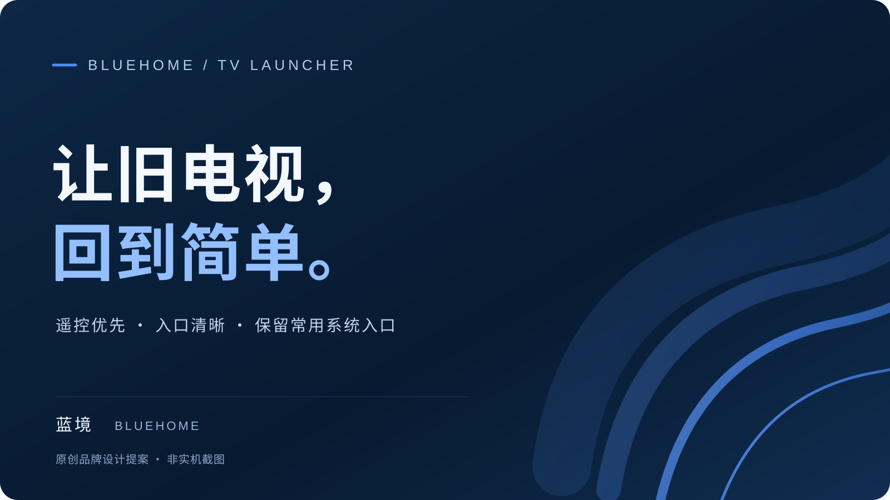

<p align="center"></p>
<h1 align="center">蓝境 · Bluehome</h1>
<p align="center">让旧电视，回到简单。</p>
<p align="center"><a href="#电视上的简单入口">特色</a> · <a href="docs/BUILD.zh-CN.md">构建</a> · <a href="docs/SOURCE-MATRIX.zh-CN.md">来源矩阵</a> · <a href="NOTICE.md">许可与署名</a></p>



蓝境是一款面向遥控器的 Android TV 桌面。当前目录提供 **14 个 Java 源文件、Manifest、最小原创资源和仅生成 unsigned APK 的构建脚本**。源码与第三方壁纸可以分开整理；这里不包含旧壁纸、字体、PNG 图标、位置配置、凭据、旧 Git 历史或签名安装包。

> 我们有权授权的蓝境新增/改写代码采用 [MIT](LICENSE)，署名 Bluehome contributors；具体范围见 [许可说明](LICENSE-SCOPE.md)。已保留 CleanYourTV 上游候选的完整 MIT 声明，不宣称全部代码原创或确定 fork 关系，也不用代码许可覆盖未知素材。

## 电视上的简单入口

### 01 · 遥控优先

有方向、确定、返回、菜单和设置键处理，应用库合并电视应用与普通 Launcher 入口。

### 02 · 保留常用系统入口

信号源、投屏、设置与原厂桌面有对应入口；部分实现针对 TCL，不承诺所有品牌通用。

### 03 · 按应用限定启动优化

3.3.1/code11 的策略只对指定 TCL 奇异果入口追加一个布尔启动参数。既有主机测试记录为 57 项断言通过；安装完成记录不能替代电视效果实测。芒果仍是独立任务，不列为已解决功能。

### 04 · 素材可替换，代码可单独构建

本候选默认使用系统字体、代码绘制的通用图标和深蓝程序背景。原摄影背景与三方图标不随源码迁入；缺少位置配置时天气不请求网络，首次时间也可能显示占位，详见下表。

## 当前候选与既有安装版的差异

| 项目 | 本源码候选 |
| --- | --- |
| 壁纸 | 空图库、程序背景，无旧照片 |
| 图标 | 缺少旧 PNG，各应用使用通用图形 |
| 字体 | 系统字体，中文字形由电视系统决定 |
| 天气/时间 | 无真实位置配置、天气种子或旧偏好；天气不可用，时间可信证据为空时可能占位 |
| 在线壁纸 | 新安装默认离线；源码保留可选客户端，仅接受官方 API 主机，移除未核实的备用服务 |
| 可选背景文件 | 引用名为 `default-background.png`，本候选未打包该图 |
| 隐藏/未启用代码 | `WaveView` 当前未被主界面启用；壁纸设置 Activity 未在现有 Manifest 注册 |
| 构建产物 | unsigned APK，仅供本地核验，不是可直接覆盖安装的发行包 |

Manifest 仍为 `local.tv.bluehome`，3.3.1/code11，minSdk21、targetSdk22。这些配置不等于全面兼容所有 Android 5+ 电视。

## 源码与开发

```text
app/
├── AndroidManifest.xml
├── src/local/tv/bluehome/   # 14 Java
├── res/                   # 原创新图标与应用名
└── assets/                # 原创空图库
tools/build_unsigned.py    # 现有本地 SDK/JDK；无下载/签名/安装
config-examples/           # dummy 位置示例，不进入 APK
third_party/               # 保留上游候选 MIT 文本
docs/
```

- [构建与依赖](docs/BUILD.zh-CN.md)
- [逐文件来源与处理](docs/SOURCE-MATRIX.zh-CN.md)
- [隐私检查范围与配置](docs/PRIVACY.zh-CN.md)
- [资源与行为差异](docs/ASSETS.zh-CN.md)
- [许可范围](LICENSE-SCOPE.md)

本次界面展示素材为原创设计提案，非实机截图。没有新采集电视画面，也未将旧图片截图纳入仓库。README 仅使用 GitHub Markdown 与简单图片 HTML 属性，不依赖任意 CSS 或脚本。
