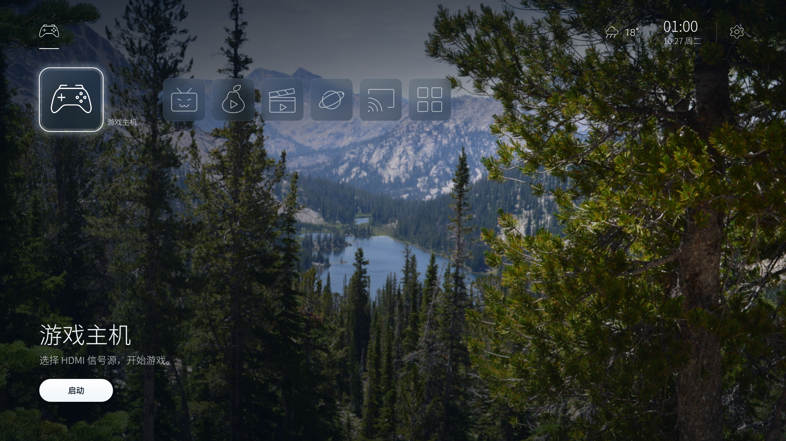

## 3.3.4 图标更新

私人电视版 3.3.4/code14 已完成同签名保数据覆盖安装，回读包版本与安装包校验一致，安装开关已恢复。遥控焦点、25 枚图标实际显示和视频入口点击尚待用户验收。

公开源码仅包含 18 枚工具图标及可编辑 SVG、芒果/酷喵图标映射。7 枚品牌适配（奇异果、芒果、酷喵、小电视、同洲院线、夸克、微信）授权未明确，未提交；缺图由既有 IconRegistry 回退到通用图标。公开版和私人电视版的素材不同，不能将私人 25 枚预览当作公开构建结果。详见 [图标范围](docs/ICONS.zh-CN.md)。
<h1 align="center">蓝境 · Bluehome</h1>

让旧电视，回到简单。

<a href="#我们做了什么">特色</a> · <a href="#当前进度">进度</a> · <a href="docs/BUILD.zh-CN.md">构建</a> · <a href="docs/SECURITY.zh-CN.md">安全边界</a>

面向遥控器的 Android TV 桌面：把常用应用、信号源与投屏入口放在容易找到的位置，让电视回到日常使用本身。

蓝境应用图标：[Android XML 源](app/res/drawable/icon.xml) · [可复用 SVG](assets/bluehome-app-icon.svg)。首页展示的是本轮已安装版使用的实际应用图标。

2026-10-26 UTC · 3.3.2/code12 · TCL Android 5.1.1 实机。私人设备构建保留原有 UI 资源；公开源码回退系统字体与通用图标。此图展示桌面，不是视频 App 去广告效果证据。

截图已审查：未见账号、二维码、位置标签或设备／网络标识；公开 PNG 为原像素复制，元数据检查通过。

当前公开源码版本为 **3.3.3 / versionCode 13**，已完成 unsigned 构建和主机测试，并在一台 TCL Android 5.1.1 电视上以原签名保留数据覆盖安装，回读版本与安装包一致。内置 Hidden Lake 的选择、恢复与再次选择是在 3.3.2/code12 上实机验证的；下方截图也来自 3.3.2，不能当作 3.3.3 的界面验收。

## 我们做了什么

- **遥控优先。** 方向、确定、返回、菜单与设置有对应处理；应用库汇集电视与普通 Launcher 入口。
- **保留电视入口。** 信号源、投屏、设置与原厂桌面有对应入口，部分实现针对 TCL。
- **启动入口按应用与版本限定。** 奇异果保留既有策略；3.3.3 为指定版本的芒果 TV、CIBN 酷喵常用卡片加入已测入口。应用库可手动普通启动，版本不匹配或入口失败会回退。蓝境内的新入口虽已安装，卡片点击与回退尚未实机验证，详见 [启动入口说明](docs/LAUNCH-ENTRIES.zh-CN.md)。
- **背景选择有明确范围。** 3.3.2 加入经过清理的内置 Hidden Lake CC0 照片及恢复先前模式功能，不提供通用图片、URL 或文件导入。
- **素材与代码分开。** 公开源码默认深蓝程序背景、系统字体与通用图标；旧壁纸、字体、PNG 图标和私人配置不随源码迁入。

## 当前进度

| 事项 | 状态 | 验证范围 |
| --- | --- | --- |
| 源码与文档 | 3.3.3 主机构建与测试通过 | 16 Java 的 unsigned 构建、两项固定素材校验、47 项入口主机断言和原壁纸回归通过；公开仓库不提供签名安装包 |
| 3.3.2 电视更新 | 一次覆盖安装完成 | 版本回读为 3.3.2/code12；未清数据、改变网络或修改官方应用，功能回归另行验证 |
| 3.3.3 电视更新 | 一次同签名覆盖安装完成 | 同一 TCL Android 5.1.1 电视回读 3.3.3/code13，安装包与已核验签名包一致，原有数据保留标记一致；新入口界面回归仍待做 |
| 爱奇艺／银河奇异果启动预览参数 | 指定版本对照有效，策略已集成 | TCL 版 **16.8.0.220465** 的一次双冷启动参数对照；3.3.1/code11 完成策略集成覆盖安装与版本回读 |
| 蓝境入口集成回归 | 尚未完成全量回归 | 安装后的卡片、应用库、回退入口与完整遥控流程仍需分别检查 |
| 本机开机进入桌面 | 原因待查 | 用户反馈开机先到 TCL，按 HOME 可回蓝境且没有「始终」选项；未发现持久首选记录不等于 HOME 无效，厂商启动链路和默认策略仍待核验 |
| 芒果 TV 启动入口 | 第三方入口有两次冷启动观察；蓝境集成待实机测 | 指定版本 7.0.912.353.3.TC_TVAPP.0.0_Release；两次用户均未见开屏／优惠／居中推广，不能推断永久无广告或后台无请求 |
| CIBN 酷喵启动入口 | 一组第三方 A/B 冷启动观察；蓝境集成待实机测 | 指定版本 13.7.1.30；布尔参数组用户见直接首页，普通组和后续普通图标见广告，未验证跨天或投放变化 |
| Hidden Lake 背景 | 实机通过 | TCL Android 5.1.1 上选择→恢复原模式→再次选择通过；恢复的是模式，不保证精确上一张，长期性能与故障回退另验 |
| 真实桌面截图 | 已采集并审查 | 1920 × 1080，3.3.2/code12；画面与元数据检查通过，私人设备构建差异见图注 |

奇异果结果只覆盖上述指定版本与一次参数对照。芒果与酷喵是第三方应用入口的有限实测观察，尚未完成蓝境 3.3.3 内的卡片、遥控、热启动、播放与回退实机回归；不宣称全 App 去广告、视频广告移除、会员或 DRM 解锁。

## 已知问题

2026-10-27，本机用户反馈开机先到 TCL 桌面，按 HOME 键会回蓝境，且没有「始终」选择项。只读检查确认电视仍安装蓝境 3.3.2/code12、HOME 候选组件存在，未发现持久 HOME 首选记录。该记录为空不能说明 HOME 键无效，也不能证明某个默认值曾被重置；厂商开机路径与默认策略仍待查。

安装与切图成功不等于开机自动进入蓝境已验证；本轮没有重启或冷开机测试。当前记录仅限本机，不推定所有设备存在同样问题。

## 背景、默认效果与恢复

公开源码将 `app/assets/builtin/hidden-lake-cc0.jpg` 作为可选内置照片，**默认仍为深蓝程序背景**。照片原尺寸为 6016 × 4000，电视使用时按界面裁切。本轮已在真实电视上完成选择并看到背景显示；这不代表长期性能、所有文字状态或不同设备均已验收。

“恢复先前背景模式”恢复选择新图之前的背景来源／模式，不保证精确回到上一张照片。旧图库或在线轮换重新运行时，实际图片可能不同。公开源码不含旧图片，恢复到缺少资源的模式时只能沿用可用背景或回退程序背景。详见 [资源与行为差异](docs/ASSETS.zh-CN.md)。

私人设备的覆盖安装包可能保留原有本地资源；该设备画面不能直接视为公开源码默认构建效果。截图说明会分别交代版本、背景和本地配置。

## 安装与兼容性

源码提供 [unsigned 构建入口](docs/BUILD.zh-CN.md)，没有随仓库提供签名发行安装包。Unsigned APK 不能直接覆盖电视现有应用；设备覆盖安装还取决于签名连续性和实际系统环境。

| 项目 | 当前范围 |
| --- | --- |
| API 配置 | minSdk21、targetSdk22，不要求触屏；最低 API 不是所有 Android 5+ 电视均已验证的声明 |
| 既有设备记录 | 蓝境 3.3.1/code11 覆盖安装与版本回读完成 |
| 电视已安装版 | 3.3.3/code13 已覆盖安装并核对版本；Hidden Lake 选择→恢复原模式→再选择的实机验证记录来自 3.3.2/code12，3.3.3 界面回归待做 |
| 厂商入口与遥控 | 当前含 TCL 适配；HDMI、投屏、不同遥控器和非 TCL 系统需要分别回归 |
| 天气与时间 | 公开源码没有真实位置或天气种子；天气默认不可用，缺少可信时间证据时可能显示占位 |

## 开发与路线图

[构建与依赖](docs/BUILD.zh-CN.md) · [启动入口](docs/LAUNCH-ENTRIES.zh-CN.md) · [变更记录](docs/CHANGELOG.zh-CN.md) · [资源与行为差异](docs/ASSETS.zh-CN.md) · [逐文件来源](docs/SOURCE-MATRIX.zh-CN.md) · [隐私配置](docs/PRIVACY.zh-CN.md) · [安全边界](docs/SECURITY.zh-CN.md) · [路线图](docs/ROADMAP.zh-CN.md)

## 贡献与许可

我们有权授权的蓝境新增／改写代码采用 [MIT](LICENSE)，署名 Bluehome contributors，范围见 [许可说明](LICENSE-SCOPE.md)。保留 [Gathin 的 CleanYourTV MIT 声明](third_party/cleanyourtv-LICENSE.txt)，不据此声称完整派生关系，也不将第三方版权重新归为蓝境。

Hidden Lake 独立采用 CC0：[Joalde 原作页面](https://commons.wikimedia.org/wiki/File:Hidden_Lake_from_far_above_08-2024.jpg) · [CC0 1.0](https://creativecommons.org/publicdomain/zero/1.0/)。作者、来源、处理方式与校验值见 [素材记录](docs/ASSETS.zh-CN.md#hidden-lake-cc0)。代码 MIT 不覆盖图片许可。

首页组织参考电视桌面项目的实机展示、使用场景、恢复与验证范围，文字、标识和展示素材自行制作。README 使用 GitHub Markdown 与简单图片属性，不依赖自定义 CSS 或脚本。
